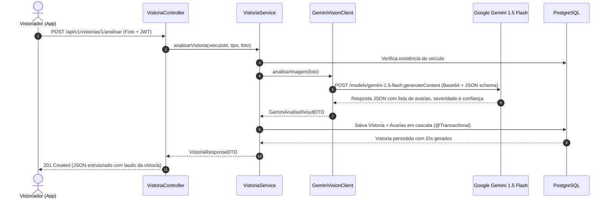

<h1 align="center">
  🚗 AutoCheck 360° & Gen AI
</h1>

<p align="center">
  <b>Sistema Inteligente de Vistorias Veiculares com Visão Computacional e IA Generativa (Google Gemini)</b>
</p>

<p align="center">
  
  
  
  
  
  
  
</p>

---

## 📌 Visão Geral & Proposta de Valor

No setor de locação de veículos e frotas de logística e entrega de alta escala (como na malha do **iFood**), o processo tradicional de vistoria veicular em entradas e devoluções sofre com:
1. **Lentidão operacional:** Processo manual com pranchetas ou formulários estáticos;
2. **Subjetividade humana:** Dificuldade em calibrar severidade de amassados, arranhões e trincas;
3. **Disputas financeiras:** Falta de comprovação auditável sobre o estado exato do veículo na entrega.

O **AutoCheck 360°** resolve esse gargalo ao integrar **IA Generativa Multimodal (Google Gemini Vision)** diretamente ao ecossistema **Spring Boot 3**. Com apenas uma foto capturada no smartphone pelo vistoriador, a IA analisa a imagem, segmenta os danos detectados (localização, descrição técnica, severidade e percentual de confiança) e persiste tudo de forma atômica e versionada em banco relacional.

---

## 🏗️ Arquitetura da Solução

```mermaid
graph TD
    User["📱 Dispositivo Móvel / Postman / Lovable UI"] -->|Multipart/form-data + Bearer JWT| Controller["VistoriaController (Spring MVC)"]
    
    subgraph SpringBootApp["Backend Spring Boot 3 (Stateless API)"]
        SecurityFilter["SecurityFilter (JWT Auth0)"] --> Controller
        Controller --> Service["VistoriaService (@Transactional)"]
        
        Service -->|1. Valida existência| VeiculoRepo["VeiculoRepository"]
        Service -->|2. Envia foto + Prompt pericial| GeminiClient["GeminiVisionClient (RestClient)"]
        Service -->|3. Salva vistoria + avarias| VistoriaRepo["VistoriaRepository"]
        
        GlobalHandler["GlobalExceptionHandler (@RestControllerAdvice)"] -.->|Captura 502 / 404 / 422| Controller
    end

    GeminiClient -->|POST /generateContent (Base64)| GeminiAPI["☁️ Google AI Studio (Gemini 1.5 Flash)"]
    VistoriaRepo -->|Persistência relacional @OneToMany| Postgres[("🐘 PostgreSQL (tb_vistoria & tb_avaria_detectada)")]
    VeiculoRepo --> Postgres
```

### 🔄 Fluxo de Inspeção com IA



---

## 🛠️ Tecnologias & Decisões de Engenharia

| Tecnologia | Finalidade | Decisão de Arquitetura |
| :--- | :--- | :--- |
| **Java 17 & Spring Boot 3.3.4** | Core da aplicação | Uso de records, novos padrões do Spring Framework 6 e Jakarta EE. |
| **Spring RestClient** | Chamada HTTP ao Gemini | Alternativa moderna ao `RestTemplate` com fluência reativa e timeouts explícitos de conexão/leitura. |
| **Google Gemini 1.5 Flash** | Visão Computacional | Modelo multimodal de altíssima velocidade e baixo custo com retorno em formato JSON estrito (`response_mime_type: application/json`). |
| **Flyway Migrations** | Versionamento do Schema | Garante evolução determinística e reproduzível do banco em CI/CD, evitando riscos de `hibernate.ddl-auto` em produção. |
| **Spring Security & JWT** | Autenticação & RBAC | Arquitetura Stateless com verificação de papéis (`ROLE_VISTORIADOR` e `ROLE_LOCADORA`) via token assinado com `HMAC256`. |
| **JUnit 5 & Mockito** | Testes Automatizados | Testes unitários com simulação de cenários da IA e testes de integração de controller com `@WebMvcTest`. |
| **Docker & Multi-Stage** | Containerização | Imagem Alpine mínima e segura rodando com usuário não-root. |

---

## 📡 Endpoints da API

### 1. Autenticação (`/api/v1/auth`)
* `POST /api/v1/auth/login`: Realiza autenticação e retorna o Bearer Token JWT.

### 2. Vistorias (`/api/v1/vistorias`)
* `POST /api/v1/vistorias/{veiculoId}/analisar`: Envia a imagem do veículo para vistoria imediata com a IA.
  * **Headers:** `Authorization: Bearer <token>`
  * **Content-Type:** `multipart/form-data`
  * **Parâmetros:** `imagem` (File), `tipo` (`ENTRADA`, `SAIDA`, `PERIODICA`)
* `GET /api/v1/vistorias/{id}`: Consulta os detalhes e avarias de uma vistoria realizada.
* `GET /api/v1/vistorias/veiculo/{veiculoId}`: Histórico de todas as vistorias de um determinado veículo.

#### Exemplo de Resposta de Vistoria (`201 Created`):
```json
{
  "id": 1,
  "veiculoId": 1,
  "dataVistoria": "2026-11-06T23:30:00",
  "tipo": "ENTRADA",
  "statusAnalise": "CONCLUIDA",
  "urlFoto": "foto_frontal_veiculo.jpg",
  "avarias": [
    {
      "id": 1,
      "localizacao": "Para-choque dianteiro direito",
      "descricao": "Arranhão profundo com remoção de tinta de aproximadamente 15cm",
      "severidade": "MEDIA",
      "confianca": 94.80
    },
    {
      "id": 2,
      "localizacao": "Farol auxiliar direito",
      "descricao": "Lente acrílica trincada",
      "severidade": "GRAVE",
      "confianca": 98.20
    }
  ]
}
```

---

## 🧪 Executando os Testes Automatizados

O projeto conta com suíte de testes unitários e de integração:

```bash
# Executa todos os testes unitários e de integração
mvn clean test
```

* **`VistoriaServiceTest`:** Valida o comportamento da regra de negócio com Mockito, cobrindo casos de detecção positiva, veículo sem avarias, veículo inexistente (404) e tolerância a falhas na IA.
* **`VistoriaControllerTest`:** Valida a camada web e segurança com `@WebMvcTest`, assegurando bloqueio sem token (`401 Unauthorized`) e liberação correta por perfil de acesso.

---

## 🚀 Como Executar Localmente

### Pré-requisitos
* Docker e Docker Compose instalados;
* Chave de API gratuita do [Google AI Studio](https://aistudio.google.com/).

### Passo a Passo

1. **Clone o repositório:**
```bash
git clone https://github.com/MayconSouza27/autocheck-360.git
cd autocheck-360
```

2. **Configure as variáveis de ambiente:**
Defina sua chave da API do Gemini:
```bash
export GEMINI_API_KEY="sua-chave-do-google-ai-studio"
```

3. **Suba o banco de dados e a aplicação via Docker Compose:**
```bash
docker compose up -d
```
A API estará disponível em `http://localhost:8080`.

4. **Importe a coleção do Postman:**
O arquivo [`AutoCheck360.postman_collection.json`](./AutoCheck360.postman_collection.json) já está na raiz do projeto com todos os endpoints e script de auto-captura de token JWT configurados.

---

## ☁️ Deploy em Nuvem (Passo 13)

* **Banco de Dados:** PostgreSQL hospedado gratuitamente no [Supabase](https://supabase.com/) ou [Render](https://render.com/). As migrations do Flyway executam automaticamente no primeiro boot.
* **Backend:** Deploy contínuo na [Render](https://render.com/) ou [Railway](https://railway.app/) conectado ao repositório GitHub com as seguintes variáveis de ambiente:
  * `DB_URL`: URL JDBC do PostgreSQL na nuvem;
  * `DB_USERNAME` e `DB_PASSWORD`: Credenciais do banco;
  * `GEMINI_API_KEY`: Chave do Google AI Studio;
  * `JWT_SECRET`: Chave secreta de produção.

---

## 🎥 Vídeo de Demonstração (Passo 14)

* 📺 **Link da demonstração (1 minuto):** [Clique aqui para assistir ao vídeo no YouTube/Loom](https://youtube.com) *(Substitua pelo link final gravado)*

---

## 👨‍💻 Autor

Desenvolvido por **Maycon Souza**  
* GitHub: [@MayconSouza27](https://github.com/MayconSouza27)  
* LinkedIn: [linkedin.com/in/mayconsouza27](https://linkedin.com)  
* Foco: Engenharia de Software Backend Java / Spring Boot & Soluções com Inteligência Artificial
